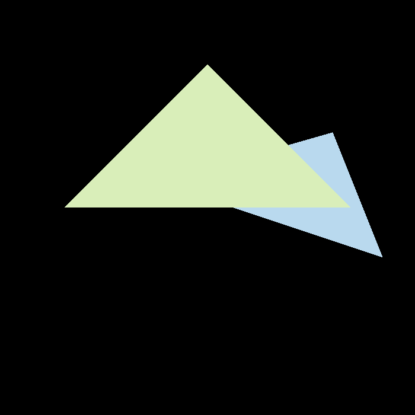
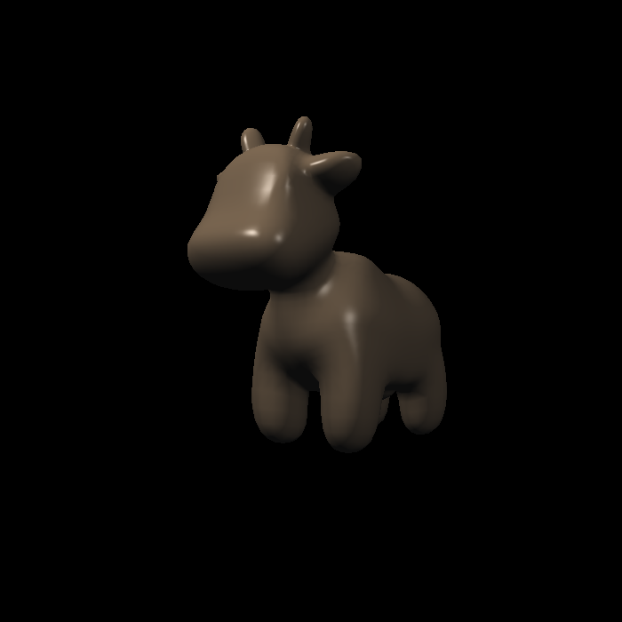
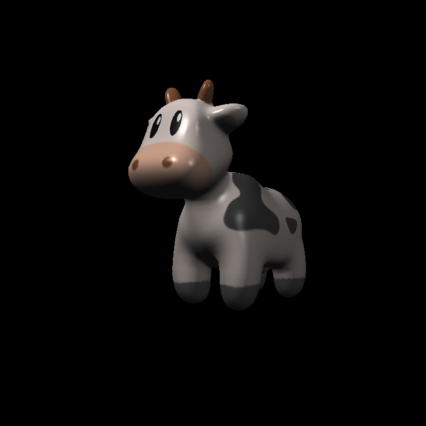

# GAMES101 Assignments

[GAMES101 计算机图形学课程](https://sites.cs.ucsb.edu/~lingqi/teaching/games101.html)的个人作业与学习记录，使用 C++20、CMake、Eigen 和 OpenCV，持续更新中。

## 作业进度

| 作业 | 内容 | 文档 |
| --- | --- | --- |
| Assignment 0 | 环境准备 | [说明](docs/assignments/assignment0/README.md) · [作业要求](docs/assignments/assignment0/pa0.pdf) |
| Assignment 1 | 旋转与投影 | [说明](docs/assignments/assignment1/README.md) · [作业要求](docs/assignments/assignment1/Assignment1.pdf) |
| Assignment 2 | 三角形光栅化与深度测试 | [说明](docs/assignments/assignment2/README.md) · [作业要求](docs/assignments/assignment2/Assignment2.pdf) |
| Assignment 3 | 着色与纹理映射 | [说明](docs/assignments/assignment3/README.md) · [作业要求](docs/assignments/assignment3/Assignment3.pdf) |

## 效果展示

### Assignment 2：三角形光栅化与深度测试



### Assignment 3：着色与纹理映射

| Blinn–Phong 光照 | 纹理着色 |
| :---: | :---: |
|  |  |

法线可视化、凹凸映射与位移着色结果见 [Assignment 3 完整对比](docs/assignments/assignment3/README.md#效果展示)。

## 构建与运行

需要 CMake 3.25+、Ninja、支持 C++20 的编译器、OpenCV 和 Eigen。目前提供 Windows（MSVC x64）构建说明，其他平台尚未验证。

依赖安装、本地配置、构建运行及 DLL 处理见 [Windows 构建指南](docs/BUILD.md)。本地依赖路径保存在不提交的 `CMakeUserPresets.json` 中，配置示例见该指南。

## 目录

```text
src/                             各作业源码及独立 CMake target
cmake/                           公共构建选项
assets/                          模型、纹理及来源记录
third_party/                     第三方 OBJ 加载器及来源记录
docs/BUILD.md                    Windows 构建与运行说明
docs/assignments/                各作业说明与材料
hooks/                           本地开发检查脚本
```

## 来源与许可

课程及作业材料来自 [GAMES101](https://sites.cs.ucsb.edu/~lingqi/teaching/games101.html)，模型与纹理来源见 [资源说明](assets/README.md)，OBJ 加载器来源见 [说明](third_party/obj_loader/README.md)。

本仓库原创代码使用 [MIT License](LICENSE)。课程材料、课程框架及第三方资源保留各自的许可与署名，不适用本仓库原创代码的许可声明。
