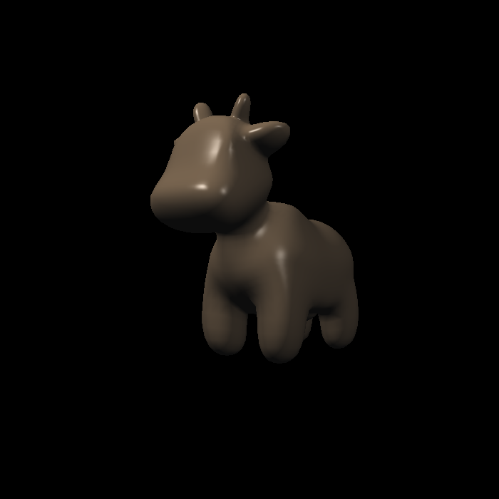
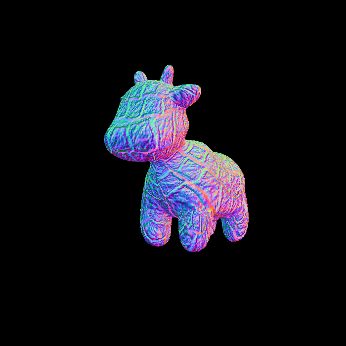
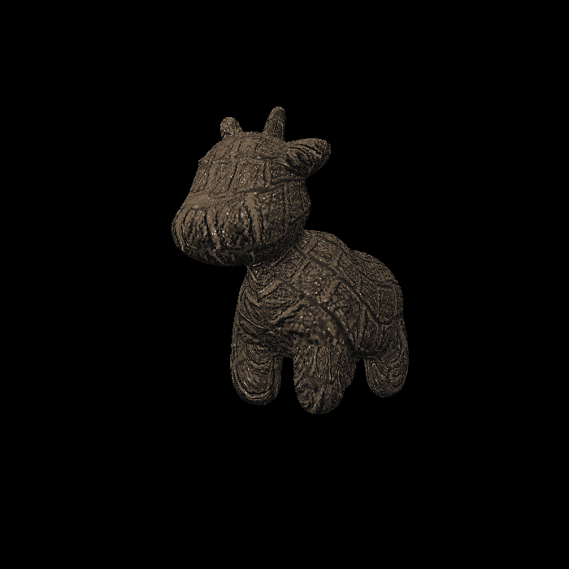

# Assignment 3：着色与纹理映射

## 效果展示

| 法线可视化（`normal`） | Blinn–Phong 光照（`phong`） | 纹理着色（`texture`） |
| :---: | :---: | :---: |
|  |  |  |

| 凹凸映射（`bump`） | 位移着色（`displacement`） |
| :---: | :---: |
|  |  |

`normal` 和 `bump` 使用颜色表示法线方向；`displacement` 在片元着色阶段偏移位置，不改变模型轮廓与深度缓冲。

## 运行

不带参数运行进入交互模式，按 `a` / `d` 旋转，按 `Esc` 退出。命令行模式接受输出文件名和可选的着色模式：

完成 [Windows 构建配置](../../BUILD.md) 后，在仓库根目录执行：

```powershell
cmake --build --preset msvc-release-local --target assignment3
build\msvc-release-local\bin\assignment3.exe output.png normal
```

着色模式支持 `normal`、`phong`、`texture`、`bump`、`displacement`，默认 `bump`。图片写入当前工作目录。

模型和纹理复用 `assets/models/spot/`，路径由 CMake 定义，无需复制到可执行文件目录。

## 着色说明

- `normal`：用颜色显示原始法线方向。
- `phong` / `texture`：使用 Blinn–Phong 光照，分别以顶点颜色或纹理颜色作为漫反射系数。
- `bump`：通过高度图差分扰动法线，用颜色显示扰动后的法线。
- `displacement`：在扰动法线的基础上，沿原法线偏移片元着色位置，再计算光照。

高度图归一化到 `[0, 1]`；光照统一在相机空间计算。这里的位移映射按课程片元着色框架实现，不改变网格轮廓或深度缓冲；要改变轮廓，需要在光栅化之前细分并移动顶点。
