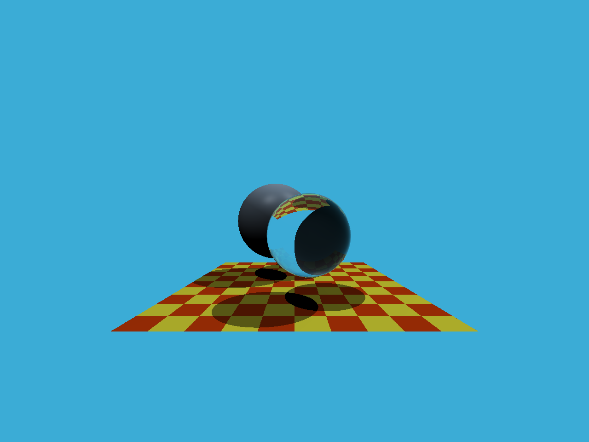

# Assignment 5：光线追踪

## 效果展示

## 实现说明

- 主光线生成：以像素中心采样，将像素坐标映射到相机成像平面，结合视场角和宽高比计算方向，并归一化。相机位于原点，朝向负 Z 轴。
- 三角形求交：使用 Möller–Trumbore 算法，排除平行或退化情况，根据重心坐标判断交点是否位于三角形内，只接受射线正方向上的交点。求交采用双面检测，不剔除背面。
- 场景渲染：沿用课程框架的球体求交、Phong 光照、阴影检测，以及结合 Fresnel 系数的递归反射与折射。

作业要求见 [PDF](assignment5.pdf)。

## 运行

程序无需交互，在当前工作目录生成 `binary.ppm`（P6 RGB 格式，1280 × 960），并在终端输出进度。可用支持 PPM 的图片查看器打开。作业 5 使用自带向量类，不单独依赖 Eigen 或 OpenCV；仓库的整体 CMake 配置仍需要这两个依赖。

上方 PNG 用于文档展示，程序仍输出 PPM。构建与运行方法见 [Windows 构建指南](../../BUILD.md)，目标名为 `assignment5`。
