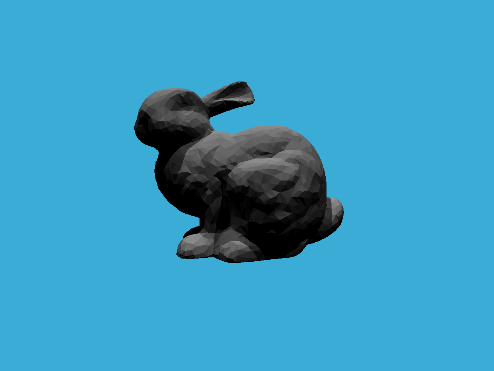

# Assignment 6：BVH 加速光线追踪

## 效果展示

使用课程提供的 Bunny 网格和逐三角形几何法线着色，因此表面保留明显的三角形明暗分面。

## 实现说明

在课程框架基础上补全四处实现：

- `Renderer::Render`：从像素中心生成归一化主光线，调用光线追踪并写入帧缓冲。
- `Bounds3::IntersectP`：使用 slab 方法求三个轴的有效交点区间，处理平行光线、边界相切和零厚度包围盒。
- `BVHAccel::GetIntersection`：未命中包围盒时剪枝，叶节点查询图元，两侧子树都命中时返回最近交点。
- `Triangle::GetIntersection`：沿用框架的 Möller–Trumbore 计算及背面剔除，排除无效交点并填充位置、法线、距离、对象和材质引用。

BVH 构建沿用框架的最长质心轴排序与中点划分，场景和网格各自持有 BVH。本作业完成基础要求，SAH 加分项尚未实现，未提供与暴力求交的性能对比。作业要求见 [PDF](PA6.pdf)。

## 运行

程序无需交互，在当前工作目录生成 `binary.ppm`（P6 RGB 格式，1280 × 960），可用支持 PPM 的图片查看器打开。

模型路径通过仓库的 `ASSETS_PATH` 定位到 `assets/models/bunny/bunny.obj`，无需复制到运行目录。

构建与运行方法见 [Windows 构建指南](../../BUILD.md)，目标名为 `assignment6`。上方 PNG 用于文档展示，程序仍输出 PPM。
