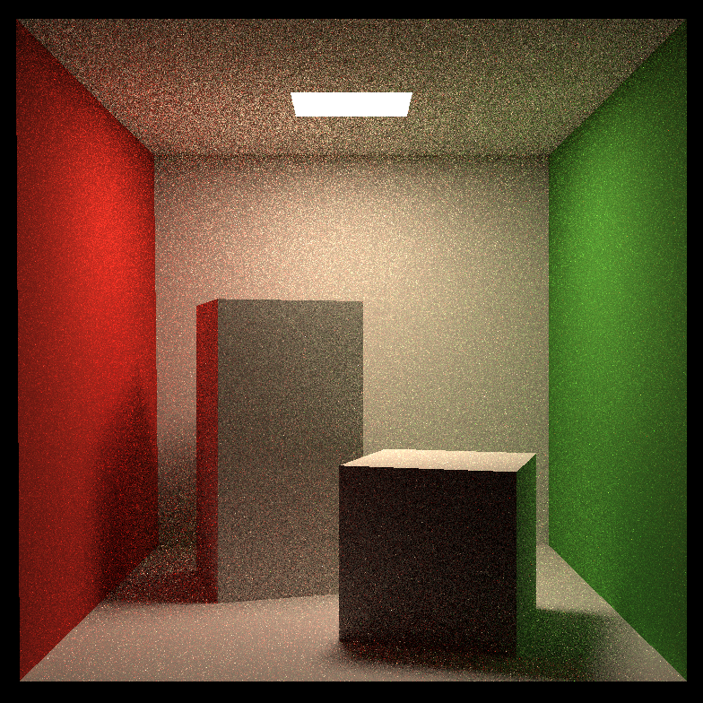

# Assignment 7：路径追踪

## 效果展示

使用顶部面光源照亮 Cornell Box，包含红绿墙面和两个盒子，可观察到软阴影及间接光照带来的颜色渗透。图中仍有明显采样噪点，可提高 `spp` 改善画面；采样次数增加也会延长渲染时间。

## 实现说明

已在课程框架基础上补全四处 TODO：

- `Bounds3::IntersectP`：使用 slab 方法计算射线与包围盒的交点区间，处理平行方向、边界相切和零厚度包围盒，并限制在射线有效范围内。
- `BVHAccel::GetIntersection`：未命中包围盒时剪枝，递归查询两侧子树并返回最近交点。
- `Triangle::GetIntersection`：补全有效交点判断，以及位置、法线、距离、对象、材质和发光信息。
- `Scene::CastRay`：通过面光源采样估计直接光照，通过漫反射半球采样递归估计间接光照，并使用 Russian Roulette 决定路径是否继续。

主光线直接命中光源时返回发光值。间接光线命中光源时返回零，这部分贡献由上一跳的面光源采样估计，避免重复计入。Russian Roulette 继续概率为 `0.8`，继续路径的间接光照除以该概率进行补偿。

当前使用漫反射材质，场景和网格 BVH 均沿用框架的 `Naive` 划分；多线程和 Microfacet 扩展尚未实现。作业要求见 [PDF](Assignment7.pdf)。

## 采样与框架修正

除四处 TODO 外，修正了以下框架问题：

- `BVHAccel::Sample`：在累计三角形面积中均匀选择位置，去掉原框架此处的 `sqrt`，使图元选择的分布与返回的面积采样密度一致。三角形内部生成均匀采样坐标所需的 `sqrt` 保留。
- `Scene::SampleLight`：返回的光源表面采样密度同时考虑“选中哪个发光网格”和“在该网格内选中哪个位置”。对于均匀面积采样，计算为 `该网格面积 / 所有发光网格总面积 × 1 / 该网格面积`，对应作业 PDF 的 `pdf_light = 1 / A`。原框架遗漏选择网格的概率，单个光源时该因子为 `1`。
- `GetRandomFloat`：每个线程复用随机数生成器，避免每次采样都重新获取种子并初始化引擎。

代码中标注了与作业 PDF 伪代码写法的差异：将间接路径的光源命中判断放在递归入口；按明确的光线方向计算光源侧余弦；通过阴影光线的 `t_max` 限制查询范围，判断着色点与采样光源之间是否存在遮挡。

为减少自相交，次级光线起点沿法线偏移 `1e-3`，该值按当前 Cornell Box 的坐标量级选取。更换场景尺度时需重新考虑这一偏移量。

## 场景与运行

模型位于 `assets/models/cornellbox/`，通过 `ASSETS_PATH` 定位，无需复制到运行目录；OBJ 加载器复用 `third_party/obj_loader/`。

- 分辨率：`784 × 784`，在 `main.cpp` 中设置。
- 相机：位置 `(278, 273, -800)`，朝向正 Z 轴，垂直视场角 `40°`。
- 默认每像素采样次数：`16 SPP`，在 `renderer.cpp` 的 `spp` 中调整；每个像素重复追踪经过像素中心的主光线，路径中的光源和反射方向随机采样。
- Russian Roulette 继续概率：`0.8`，通过 `Scene::GetRussianRoulette()` 获取。
- 输出：当前工作目录的 `binary.ppm`，P6 RGB 格式，沿用框架的 `0.6` 次幂输出变换。

材质由 `main.cpp` 持有，网格引用材质，场景引用网格；使用场景期间需保持这些对象有效。

构建与运行方法见 [Windows 构建指南](../../BUILD.md)，目标名为 `assignment7`。上方 PNG 用于文档展示，程序仍输出 PPM。
