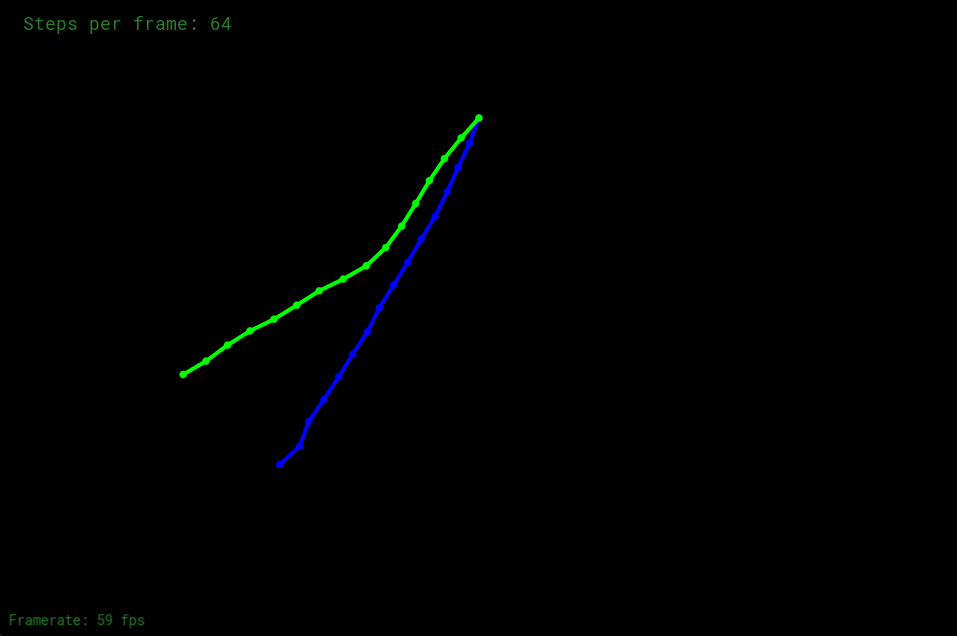

# Assignment 8：质点弹簧绳子模拟

## 效果展示



蓝色绳子为带阻尼的半隐式 Euler 模拟，绿色绳子为带阻尼的 Verlet 预测与距离约束修正。截图中的每帧模拟子步数为 `64`，两根绳子共享相同的初始端点和固定节点设置。

## 实现说明

已补全绳子初始化、Euler、Verlet 和阻尼。作业要求见 [PDF](assignment8.pdf)。

- **绳子初始化**：在起点与终点之间均匀创建质点，连接相邻质点形成弹簧，并标记指定的固定节点；检查节点数、质量、刚度、端点和固定节点索引。
- **Euler**：按 Hooke 定律向弹簧两端累加大小相等、方向相反的力，加入重力和 `F_d = -0.01 × v` 的全局阻尼力。默认先更新速度，再用新速度更新位置，即半隐式 Euler；显式 Euler 的位置更新保留为注释，按旁边说明切换即可对比。
- **Verlet**：使用 `x_next = x + (1 - damping) × (x - x_previous) + a × dt²` 预测位置，阻尼系数按作业要求取 `0.00005`。随后每个子步执行 8 轮距离约束投影，使相邻质点距离近似保持弹簧原长。
- **固定点与状态**：固定节点不参与位置更新；约束修正按可动节点的逆质量分配，等质量的两个可动端各承担一半，仅一个端点可动时承担全部修正。每个子步结束清空所有质点的合力。

Verlet 按 PDF 描述的无限刚度约束模型实现，不叠加 Hooke 弹簧力；Euler 使用有限刚度的弹簧力。因此两条绳子的差异同时包含物理模型和积分方法的差异。距离约束在预测位置后执行，以修正本步运动造成的长度变化；有限轮次的投影仍允许少量约束误差。

## 代码与依赖

- `src/assignment8/`：作业代码，文件名、命名和格式遵循仓库规范。作业类型位于 `assignment8` 命名空间；覆盖 CGL 虚函数的 `init`、`render`、`resize`、`name`、`info`、`key_event` 保留接口名称。
- `third_party/cgl/`：课程自带的窗口、绘制及文字显示框架，包括 GLFW、GLEW 和字体数据，保留其源码格式及接口，仅适配构建。来源与改动见 [CGL 说明](../../../third_party/README.md#cgl)。
- `third_party/freetype/`：FreeType 2.15.0（`VER-2-15-0`），用于 CGL 的屏幕文字，与 GLFW、GLEW 一起从源码构建为静态库，无需另外安装。来源和构建选项见 [FreeType 说明](../../../third_party/README.md#freetype)。OpenGL 通过系统开发环境提供。

绳子通过 `std::unique_ptr` 持有质点和弹簧，弹簧端点为不持有所有权的 `Mass*`；初始化时使用 `std::make_unique` 创建对象，并通过质点指针的 `.get()` 连接弹簧端点。

`Application` 持有两根绳子；CGL Viewer 在析构时释放 Application，入口代码按此约定转移所有权。命令行解析使用标准 C++，不依赖原框架的 `unistd.h/getopt`，并修正了 `-g` 参数和键盘回调接口。

## 构建与运行

目标名为 `assignment8`，与其他作业使用相同的配置和构建流程；所需第三方库由 CMake 自动从源码构建。Windows 构建命令见 [构建指南](../../BUILD.md)，将示例中的目标名替换为 `assignment8` 即可。

运行示例：

```shell
build\msvc-release-local\bin\assignment8.exe -m 1 -g 0 -1 -s 64
```

| 参数 | 含义 | 默认值 |
| --- | --- | --- |
| `-m <FLOAT>` | 每个质点的质量，必须大于零 | `1` |
| `-g <FLOAT> <FLOAT>` | 重力加速度的 X、Y 分量 | `(0, -1)` |
| `-s <INT>` | 每帧模拟子步数，必须为正整数 | `64` |
| `-h` / `--help` | 显示命令行帮助 | — |

两根绳子的端点为 `(0, 200)` 与 `(-400, 200)`，按作业要求将节点数从框架默认的 `3` 增加为 `16`，弹簧刚度为 `100`，固定节点索引为 `0`。节点数在 `application.cpp` 的 `num_nodes` 中调整。

蓝色用于 Euler 模拟，绿色用于 Verlet 模拟；`-` 键将每帧子步数减半，`=` 键将其加倍，`Esc` 关闭窗口，反引号键切换屏幕信息显示。

沿用课程框架的时间步设置：每帧调用指定次数的模拟函数，每个子步的 `delta_t = 1 / steps_per_frame`，没有按真实帧间耗时推进模拟。程序使用交互窗口，不会自动保存结果图片，也不需要额外复制模型或字体资源。

## 步长与交互限制

`-` 会减少子步数，使每个子步的 `delta_t` 增大。半隐式 Euler 仍有稳定性限制；子步数过少时，蓝色绳子可能数值发散并飞出窗口，已发散的状态需要重启程序恢复。

Verlet 会记录历史位置对应的时间步。运行中改变子步数时，惯性位移乘以新旧步长之比，加速度项使用 `a × dt_new × (dt_old + dt_new) / 2`，避免直接复用旧步长的位移造成速度突变。步长不变时，加速度项仍为 `a × dt²`。
